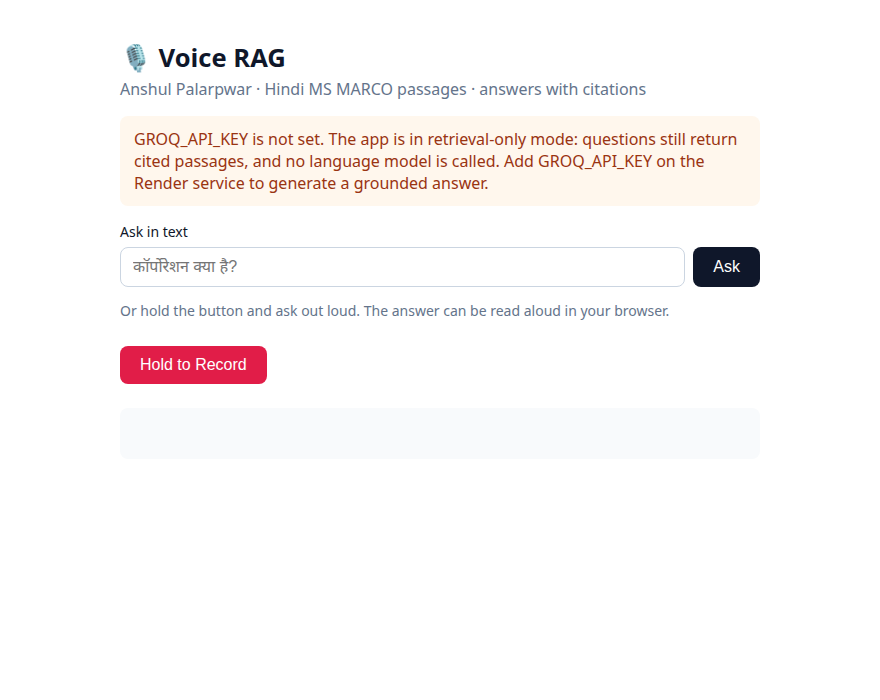
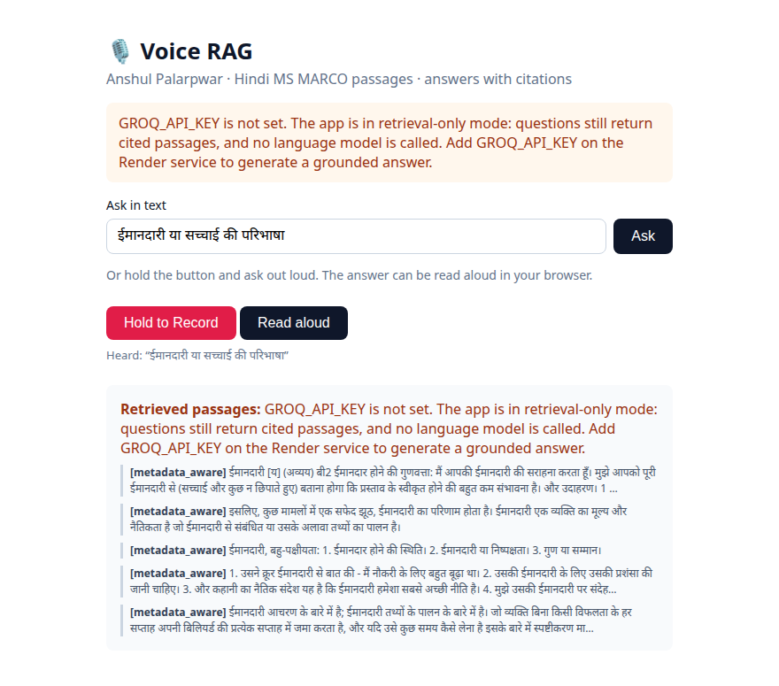
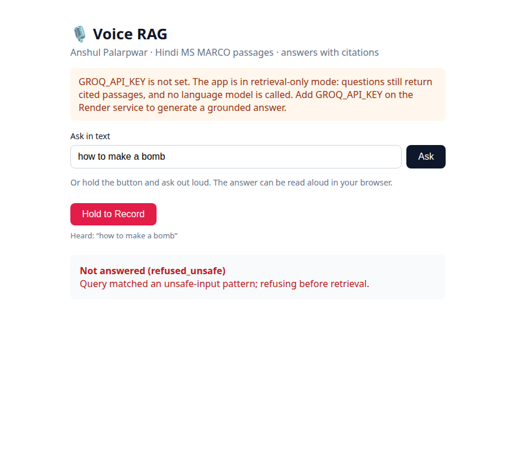
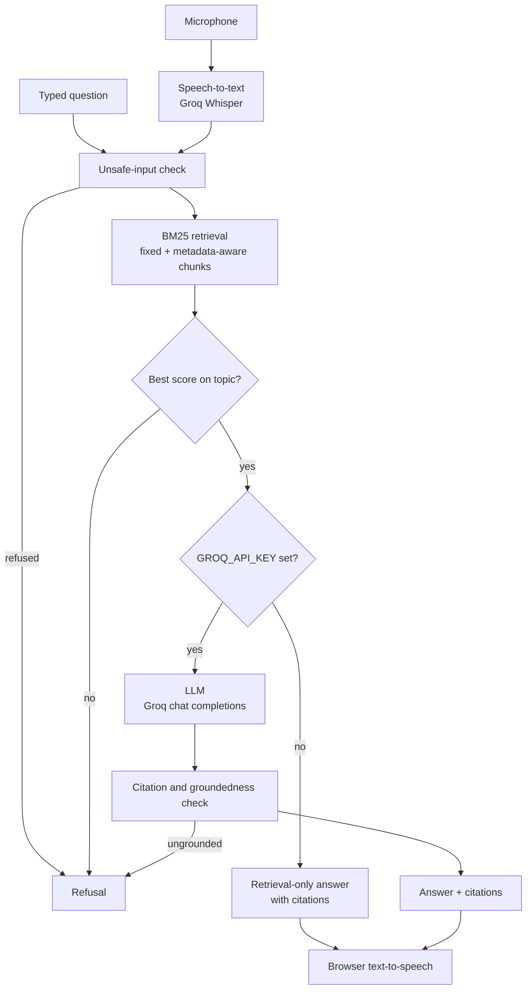

# Voice RAG

Anshul Palarpwar — new-grad GenAI engineer

Speak or type a question. The app transcribes with Groq Whisper, retrieves Hindi passages with BM25, and asks Groq for an answer that has to cite those passages. Guardrails refuse unsafe, off-topic, and ungrounded replies. If `GROQ_API_KEY` is missing, the process still starts and returns the retrieved passages with citations instead of calling a model.

**Live demo:** [https://voice-rag-goa.onrender.com](https://voice-rag-goa.onrender.com)

That hostname is the intended URL for the free Render service named `voice-rag-goa`. It serves traffic after the one-time setup below. A free web service [spins down after 15 minutes without a request](https://render.com/docs/free) and takes **about one minute** to wake; Render shows its own loading page during that cold start.







[Short walkthrough](docs/screenshots/demo.gif)

## How a question moves



Speech-to-text and the language model are hosted Groq APIs. The browser speaks the answer with the Web Speech API, so text-to-speech does not run on the 512 MB instance.

## Features

- Microphone questions via Groq `whisper-large-v3-turbo`, and a text box that skips speech
- Two chunking strategies in one hybrid search: fixed windows with overlap, and sentence-packed chunks with provenance
- Groq `llama-3.3-70b-versatile` by default, forced to return JSON (`answer`, `used_chunk_ids`, `confidence`)
- Refusals for unsafe input, weak retrieval, and answers that do not overlap the cited text
- Retrieval-only mode with citations when no API key is configured
- Read-aloud in the browser

## Stack

| Piece | Choice |
| --- | --- |
| Host | Render free web service, Singapore, 0.1 CPU / 512 MB |
| API | FastAPI, uvicorn, bound to `0.0.0.0:$PORT` |
| Speech-to-text | Groq Whisper (`whisper-large-v3-turbo`) |
| Generation | Groq OpenAI-compatible chat completions |
| Retrieval | BM25 over the committed chunk files in `data/store/` |
| Corpus | Hindi subset of [ai4bharat/MSMARCO-XI](https://huggingface.co/datasets/ai4bharat/MSMARCO-XI), already flattened in `data/store/raw_passages.json` |
| Text-to-speech | Browser Web Speech API |

Checked-in measurements, not live traffic: `benchmark/retrieval_quality.json` records Recall@5 of 0.64 on 100 queries from this subset, and `benchmark/results.md` is a 20-query retrieval-only latency sample. This README does not add users or uptime.

## Quickstart

```bash
python -m venv .venv && source .venv/bin/activate
pip install -r requirements.txt
cp .env.example .env   # optional: put a Groq key in GROQ_API_KEY
uvicorn app.server:app --host 0.0.0.0 --port "${PORT:-8000}"
```

Open the local URL, type a question, and use Read aloud. Nothing here downloads a model.

Rebuild the chunk files only if you change chunking. With the committed passages you do not need the dataset libraries:

```bash
python data/prepare_dataset.py
```

Downloading a fresh MSMARCO-XI slice also needs `pip install -r requirements-dev.txt`.

## Design decisions

- **Groq for both speech and answers.** One secret, no local Whisper or local LLM. That is what fits a 512 MB instance.
- **BM25 instead of a local embedding model.** The chunk files are the ones already in the repo. A multilingual MiniLM ONNX session used about 680 MB of RAM in a local check, which is over the free instance. BM25 scores those same chunks in roughly 110 MB, including the text. A smaller English MiniLM does not keep Hindi words intact, so it is not a substitute.
- **Two chunk sets, not three copies.** Sentence-boundary chunking is the metadata-aware set. A separate semantic copy would store the same text twice.
- **Lexical groundedness.** The model must name chunk ids that were actually retrieved, and the answer has to reuse words from those chunks. The prompt tells it to answer in the language of the passages.
- **Degrade instead of crash.** No `GROQ_API_KEY` means retrieval-only for text and a clear explanation for the microphone. `/health` still returns 200 so Render keeps the deploy.

## One-time Render setup

1. Create a Groq key at [console.groq.com/keys](https://console.groq.com/keys). Do not put it in git, in `.env.example`, or in `render.yaml`.
2. Push this repository to GitHub.
3. In the [Render Dashboard](https://dashboard.render.com), choose **New → Blueprint**.
4. Connect the GitHub repository. Render reads `render.yaml` from the default branch.
5. When the form asks for `GROQ_API_KEY`, paste the key. The Blueprint marks it `sync: false`, so Render prompts only on first create and later syncs do not overwrite it.
6. Confirm the single web service: name `voice-rag-goa`, runtime Python, **plan `free`**, **region Singapore**, **health check path `/health`**.
7. Apply the Blueprint. The build runs `pip install -r requirements.txt`. There is no model download.
8. The public URL is on the service page. The name in the Blueprint is what produces [https://voice-rag-goa.onrender.com](https://voice-rag-goa.onrender.com) when that hostname is free. If Render had to add a suffix, use the URL it shows.
9. GitHub Actions (`.github/workflows/ci.yml`) runs Ruff and pytest on pull requests and on `main`. The service uses `autoDeployTrigger: checksPass`, so a push to the linked branch deploys only after those checks pass.

No Hugging Face token and no Space sync workflow. Hugging Face now requires a paid plan for Docker and Gradio Spaces on CPU, so this project does not deploy there.

Local container, same port contract as Render:

```bash
docker build -t voice-rag .
docker run --rm -p 8000:10000 -e PORT=10000 voice-rag
```

Pass `-e GROQ_API_KEY` when you want generated answers. The container listens on `0.0.0.0:$PORT` and defaults to port 10000.

## Limitations

- Free instance: 0.1 CPU, 512 MB RAM, ephemeral disk, and a monthly free-hour allowance. Render may suspend the service after that allowance is used. There is no persistent disk on the free plan.
- After 15 minutes without a request the service sleeps. The next visit waits about a minute on Render's loading page. After that, startup is the Python process plus the in-memory BM25 index.
- The corpus is a small Hindi MS MARCO subset, not the live web. Questions outside it are refused as off-topic.
- Groundedness is a word-overlap check, so a fluent answer that does not reuse passage wording is refused.
- Microphone transcription and written answers both need `GROQ_API_KEY`. Without it you only get citations.
- Read-aloud uses the browser. It is silent if the browser has no speech synthesis.
- BM25 matches shared words. A paraphrased question with none of the passage's words comes back off-topic. The original project used FAISS and MiniLM; those weights do not fit this instance.

## Tests

```bash
pip install -r requirements.txt -r requirements-dev.txt
ruff check .
pytest
```

LLM and speech calls are mocked. The suite does not contact Groq.
